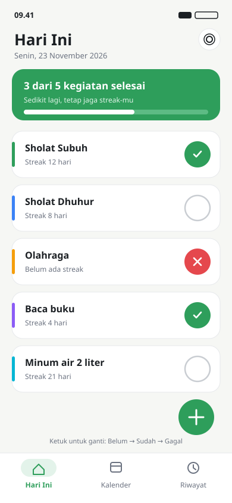
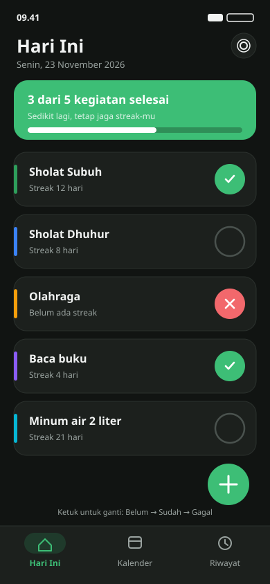
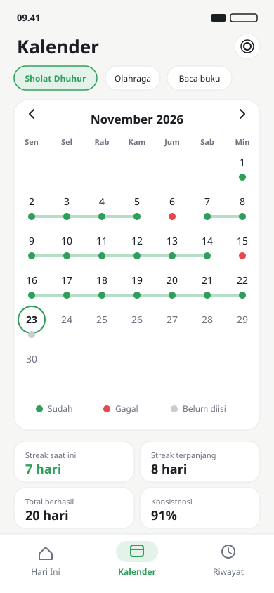
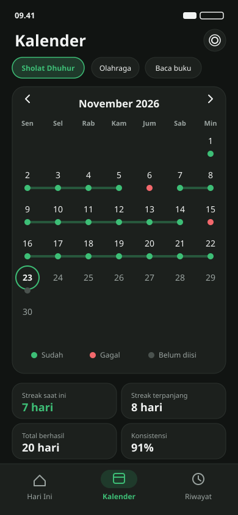
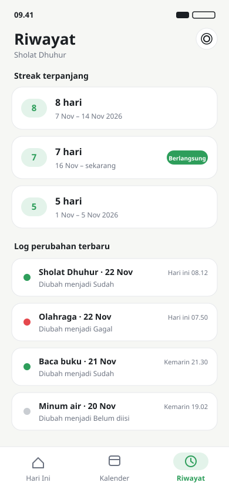
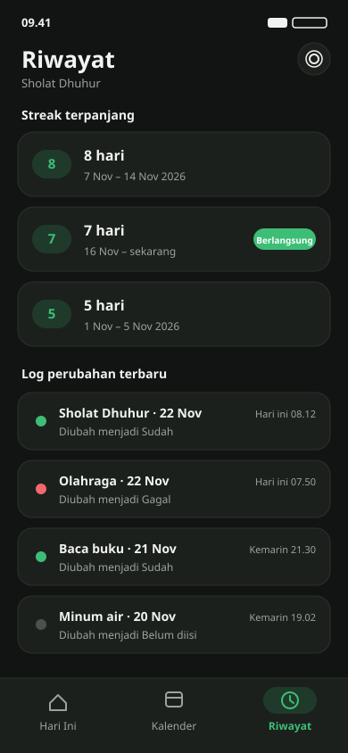
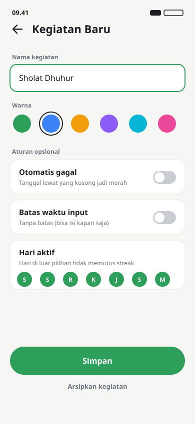
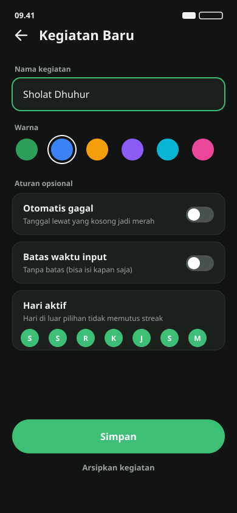

# Streakku

Aplikasi pelacak kebiasaan dan kegiatan harian (*daily habit & streak tracker*) berbasis Android native yang dibangun dengan **Kotlin** dan **Jetpack Compose**. Mengusung prinsip **100% Offline-First**, Streakku menyimpan seluruh data secara lokal di perangkat menggunakan **Room SQLite**, menjamin privasi pengguna tanpa analitik, tanpa iklan, dan tanpa memerlukan akun *login*.

---

## Overview

Membangun konsistensi dalam kebiasaan positif sering kali terhambat oleh aplikasi pelacak yang terlalu rumit, penuh iklan, meminta pendaftaran akun, atau mewajibkan sinkronisasi ke server pihak ketiga. Selain itu, banyak pelacak kebiasaan tidak memperhitungkan fleksibilitas jadwal (seperti hari istirahat/akhir pekan) serta memberikan penalti streak yang kaku ketika pengguna belum sempat memperbarui status di hari yang sama.

**Streakku** dirancang untuk menjawab permasalahan tersebut dengan menghadirkan:
- **Tujuan Utama**: Membantu pengguna memantau progres rutinitas harian dengan antarmuka yang bersih, intuitif, dan responsif.
- **Fokus Privasi & Kecepatan**: Semua pencatatan diproses langsung di penyimpanan lokal perangkat, sehingga aplikasi dapat berjalan cepat seketika tanpa memerlukan koneksi internet.
- **Fleksibilitas Penjadwalan**: Mendukung hari aktif kustom (misal hanya hari kerja atau akhir pekan), batas waktu pengisian retroaktif (*backfill limit*), dan logika streak yang adil tanpa langsung memutus rekor hanya karena belum mengisi status di hari berjalan.
- **Target Pengguna**: Individu, pelajar, profesional, dan siapa saja yang ingin membangun rutinitas produktif atau kebiasaan hidup sehat dengan kontrol penuh atas data pribadinya.

---

## Features

Berdasarkan implementasi kode pada arsitektur aplikasi saat ini, berikut adalah fitur-fitur yang telah selesai dan berfungsi penuh:

### 1. Dasbor "Hari Ini" & One-Tap Status Cycle
- Menampilkan daftar kegiatan yang dijadwalkan pada hari aktif saat ini.
- **Kartu Ringkasan Progres**: Banner visual yang menampilkan perbandingan kegiatan yang telah diselesaikan terhadap total kegiatan yang dijadwalkan hari ini.
- **Siklus Status Sekali Ketuk**: Mengubah status kegiatan dengan alur: `Belum Diisi` (Abu-abu) &rarr; `Sudah Dilakukan` (Centang Hijau) &rarr; `Gagal / Terlewat` (Silang Merah) &rarr; kembali ke `Belum Diisi` (menghapus rekaman entri).
- **Bagian Hari Istirahat (*Off-Day*)**: Kegiatan yang tidak dijadwalkan pada hari tersebut dikelompokkan secara terpisah dan tidak memengaruhi perhitungan streak hari berjalan.

### 2. Kalender Interaktif & Pengisian Riwayat
- Visualisasi kalender bulanan interaktif dengan selektor kegiatan.
- Setiap tanggal menampilkan indikator visual status: centang hijau (*done*), silang (*failed*), kosong, atau ikon gembok (*locked*).
- **Bottom Sheet Tanggal Lampau**: Pengguna dapat mengetuk tanggal lampau untuk memperbarui status kegiatan, dengan validasi aturan kunci (*lock validation*).

### 3. Mesin Kalkulasi Streak & Analisis Konsistensi
- **Perhitungan Streak Cerdas**: Hari berjalan yang berstatus `Belum Diisi` atau `Hari Istirahat` tidak memutus streak yang sedang berjalan dari hari aktif sebelumnya.
- **Panel Statistik Komprehensif**:
  - *Current Streak*: Jumlah hari berturut-turut yang berhasil diselesaikan hingga saat ini.
  - *Longest Streak*: Rekor streak terpanjang yang pernah dicapai sepanjang waktu.
  - *Konsistensi 30 Hari*: Persentase keberhasilan kegiatan dalam jendela 30 hari terakhir.
  - *Konsistensi Sepanjang Waktu*: Persentase total hari selesai dibandingkan total hari aktif sejak kegiatan dibuat.

### 4. Riwayat Streak & Log Audit (*Change Log*)
- **Filter Kegiatan**: Memfilter riwayat berdasarkan kegiatan tertentu atau melihat rekap seluruh kegiatan.
- **Daftar Rekam Jejak Streak**: Menampilkan daftar rekor streak masa lalu lengkap dengan tanggal mulai, tanggal selesai, total hari, dan status berjalan (*ongoing*).
- **Log Perubahan (*Audit Trail*)**: Setiap perubahan status kegiatan otomatis dicatat ke tabel *change logs* lokal beserta stempel waktu (*timestamp*) untuk transparansi data.

### 5. Kustomisasi Kegiatan Tingkat Lanjut (*Habit Form*)
- Penamaan kegiatan dan pemilihan palet warna aksen (*hex color palette*).
- **Hari Aktif Kustom**: Memilih kombinasi hari kerja, akhir pekan, atau hari tertentu (Senin–Minggu).
- **Fitur Auto-Fail (Opsional)**: Tanggal lampau yang terlewat tanpa diisi otomatis dihitung sebagai gagal ketika hari telah berganti.
- **Batas Waktu Pengisian Retroaktif (*Backfill Limit*)**: Membatasi pengisian tanggal lampau (misal: hanya boleh mengubah data maksimal 7 hari ke belakang) untuk mencegah manipulasi streak masa lalu.
- **Manajemen Arsip**: Menyembunyikan kegiatan yang sudah tidak aktif dari daftar utama tanpa menghapus data historisnya.

### 6. Pengingat Harian (*Daily Reminder Notification*)
- Penjadwalan notifikasi pengingat harian menggunakan **AndroidX WorkManager**.
- Pemilih waktu (*TimePicker*) dialog untuk menentukan jam dan menit pengingat.
- Penanganan izin notifikasi dinamis (`POST_NOTIFICATIONS`) untuk Android 13 (API 33) ke atas.
- Receiver otomatis (`ReminderBootReceiver`) untuk menjadwalkan ulang alarm saat perangkat dinyalakan ulang (*reboot*) atau zona waktu berubah.

### 7. Cadangan & Pemulihan Data Mandiri (*Backup & Restore*)
- **Ekspor JSON**: Mengekspor seluruh konfigurasi kegiatan dan riwayat entri ke berkas JSON lokal melalui Android Storage Access Framework (SAF).
- **Impor JSON & Validasi Skema**: Memvalidasi integritas struktur berkas cadangan (*Schema Version 1*).
- **Mesin Penggabungan Cerdas (*Last-Write-Wins*)**: Menggabungkan data cadangan ke basis data yang ada berdasarkan stempel waktu pembaruan terbaru (`updatedAt`) tanpa menduplikasi data.

### 8. Privasi Penuh & 100% Offline
- Aplikasi tidak mendeklarasikan izin akses internet (`android.permission.INTERNET`).
- Data tidak pernah dikirim ke peladen luar, tidak ada pelacak pihak ketiga, dan sepenuhnya tersimpan aman di direktori privat aplikasi.

---

## Screenshots

Berikut adalah tangkapan layar antarmuka pengguna Streakku dalam mode Terang (*Light Mode*) dan mode Gelap (*Dark Mode*) yang bersumber dari aset desain resmi proyek:

| Layar | Tampilan Mode Terang | Tampilan Mode Gelap |
| :--- | :---: | :---: |
| **Hari Ini (Today)** |  |  |
| **Kalender (Calendar)** |  |  |
| **Riwayat (History)** |  |  |
| **Form Kegiatan (Form)** |  |  |

> **Catatan Rekomendasi:** Untuk keperluan rilis produksi di masa mendatang, disarankan menambahkan tangkapan layar langsung dari perangkat fisik (*real device mockups*) yang menampilkan dialog pemilih waktu (*TimePicker*) dan notifikasi sistem Android.

---

## Tech Stack

Teknologi dan pustaka yang digunakan dalam proyek ini diverifikasi langsung dari konfigurasi `build.gradle.kts` dan `gradle/libs.versions.toml`:

| Komponen | Teknologi / Pustaka | Versi Aktual | Fungsi Utama |
| :--- | :--- | :--- | :--- |
| **Bahasa Pemrograman** | Kotlin | `2.4.21` | Bahasa utama pengembangan Android |
| **UI Framework** | Jetpack Compose (BOM) | `2024.09.00` | Deklaratif UI modern Android |
| **Desain Sistem** | Material Design 3 | Material3 Compose | Komponen UI, tema, dan tipografi adaptif |
| **Navigasi** | Navigation Compose | `2.8.9` | Manajemen rute dan navigasi antar layar |
| **Basis Data Lokal** | Android Room (SQLite) | `2.7.0` | Penyimpanan lokal relasional (Entities, DAOs) |
| **Annotation Processing** | Google KSP | `2.3.5` | Pemrosesan anotasi Room & kode generasi cepat |
| **Preferensi Lokal** | DataStore Preferences | `1.1.7` | Penyimpanan pengaturan tema dan pengingat |
| **Penjadwalan Latar Belakang** | AndroidX WorkManager | `2.10.0` | Penjadwalan pengingat harian yang andal |
| **Build Tooling** | Android Gradle Plugin (AGP) | `9.1.1` | Sistem kompilasi dan pengemasan Android |
| **Build Automation** | Gradle Wrapper | `9.3.1` | Automasi build dan resolusi dependensi |
| **Unit & Integration Test** | Robolectric & JUnit 4 | `4.16.1` / `4.13.2` | Pengujian unit dan simulasi lingkungan Android |

---

## Project Structure

Struktur direktori utama proyek ditata mengikuti arsitektur berlapis (*layered Clean Architecture*) yang memisahkan tanggung jawab logika domain, data, dan antarmuka pengguna:

```text
Streakku/
├── app/
│   ├── src/
│   │   ├── main/
│   │   │   ├── java/com/example/
│   │   │   │   ├── data/
│   │   │   │   │   ├── backup/          # Enkoder & Dekoder JSON mandiri untuk backup/restore
│   │   │   │   │   ├── local/           # Room Database, DAOs, dan Entities (habits, entries, change_logs)
│   │   │   │   │   ├── preferences/     # DataStore repository untuk preferensi pengguna
│   │   │   │   │   └── repository/      # Implementasi konkret HabitRepository berbasis Room
│   │   │   │   ├── domain/
│   │   │   │   │   ├── logic/           # Mesin kalkulasi streak (StreakCalculator) & penggabungan backup
│   │   │   │   │   ├── model/           # Model data domain murni (Habit, Entry, Stats, AppSettings)
│   │   │   │   │   ├── repository/      # Kontrak interface abstraksi repository
│   │   │   │   │   └── time/            # Utilitas tanggal lokal (DateTicker, IndonesianDateFormatter)
│   │   │   │   ├── reminder/            # WorkManager DailyReminderWorker & BroadcastReceiver
│   │   │   │   ├── ui/
│   │   │   │   │   ├── components/      # Komponen Compose atomik (kartu, dot warna, indikator)
│   │   │   │   │   ├── navigation/      # Definisi rute navigasi dan tab utama
│   │   │   │   │   ├── screens/         # Tampilan layar (Today, Calendar, History, Form, Settings)
│   │   │   │   │   ├── theme/           # Definisi warna Material 3, tipografi, dan tema aplikasi
│   │   │   │   │   └── StreakkuViewModel.kt # State management terpusat (UDF)
│   │   │   │   ├── MainActivity.kt      # Titik masuk utama aplikasi (Single Activity Architecture)
│   │   │   │   └── StreakkuApplication.kt # Inisialisasi tingkat aplikasi
│   │   │   └── res/                     # Sumber daya XML (strings, drawables, icons, mipmap)
│   │   └── test/                        # Pengujian unit & integrasi Robolectric
│   └── build.gradle.kts                 # Konfigurasi dependensi dan build modul app
├── gradle/
│   ├── wrapper/                         # Gradle wrapper binary dan konfigurasi
│   └── libs.versions.toml               # Version catalog terpusat untuk dependensi
├── public/
│   └── assets/aistudio/                 # Aset grafis SVG representasi antarmuka aplikasi
├── build.gradle.kts                     # Konfigurasi root Gradle
├── gradle.properties                    # Konfigurasi JVM arguments dan performa build
├── metadata.json                        # Metadata identitas proyek
└── settings.gradle.kts                  # Resolusi repositori plugin dan dependensi
```

---

## Requirements

Untuk menjalankan dan mengembangkan proyek ini di lingkungan lokal, pastikan perangkat memenuhi spesifikasi berikut:

### Kebutuhan Perangkat (Runtime)
- **Minimum OS**: Android 8.0 (Oreo, API level 26)
- **Target OS**: Android 15 (API level 35) / Android 16 (API level 36)
- **Dukungan Arsitektur**: `arm64-v8a`, `armeabi-v7a`, `x86`, `x86_64`

### Kebutuhan Pengembangan (Development Tools)
- **IDE**: Android Studio Ladybug (2024.2.1+) atau versi lebih baru
- **Java Development Kit (JDK)**: OpenJDK 17 atau OpenJDK 21 (direkomendasikan JDK 21 LTS)
- **Android SDK**: Android SDK Platform 35 atau 36 terpasang lengkap dengan Build-Tools `35.0.0` atau `36.0.0`
- **Gradle**: Versi `9.3.1` (dijalankan otomatis melalui Gradle Wrapper)

---

## Installation and Setup

Ikuti langkah-langkah berikut untuk mengkloning dan menjalankan proyek di Android Studio:

### 1. Kloning Repository
```bash
git clone https://github.com/dirhamhakim/streakku.git
cd streakku
```

### 2. Membuka di Android Studio
1. Buka **Android Studio**.
2. Pilih menu **File &rarr; Open...**, lalu arahkan ke direktori proyek `streakku`.
3. Tunggu hingga proses **Gradle Sync** dan pengunduhan dependensi selesai secara otomatis.

### 3. Konfigurasi Lingkungan
Proyek ini dirancang sebagai aplikasi *offline-first* mandiri. Salin file template lingkungan jika diperlukan oleh build tooling:
```bash
cp .env.example .env
```
*(Catatan: Proyek tidak mewajibkan pengisian API key pihak ketiga untuk fungsi pencatatan streak offline).*

### 4. Menjalankan Aplikasi
1. Hubungkan perangkat fisik Android melalui kabel USB (dengan *USB Debugging* aktif) atau nyalakan Android Virtual Device (Emulator).
2. Tekan tombol **Run (Shift + F10)** pada toolbar Android Studio untuk melakukan kompilasi dan memasang aplikasi ke perangkat.

---

## Build APK

Anda dapat membuat berkas instalasi APK secara mandiri melalui terminal menggunakan Gradle Wrapper:

### Build APK Debug (Untuk Pengujian Langsung)
```bash
# Untuk Linux / macOS
./gradlew assembleDebug

# Untuk Windows (Command Prompt / PowerShell)
.\gradlew.bat assembleDebug
```

Setelah proses kompilasi selesai dengan status `BUILD SUCCESSFUL`, berkas APK hasil build dapat ditemukan pada lokasi:
```text
app/build/outputs/apk/debug/app-debug.apk
```

Berkas APK debug ini telah ditandatangani dengan kunci debug (*Android debug keystore*) dan dapat langsung dipasang (*sideload*) ke ponsel Android 8.0 hingga Android 15/16.

### Menjalankan Pengujian Otomatis (*Unit & Robolectric Tests*)
Untuk memverifikasi kebenaran kalkulasi streak dan persistensi data sebelum merilis:
```bash
.\gradlew.bat testDebugUnitTest
```

---

## Development Notes

Proyek ini dirancang dan dikembangkan dengan memanfaatkan **Google AI Studio** sebagai alat bantu akselerasi pengembangan (*developer tooling & prototyping assistant*). Google AI Studio digunakan untuk membantu eksplorasi desain awal, penyusunan skema antarmuka, serta perumusan struktur data awal.

Seluruh *runtime*, logika bisnis (*StreakCalculator*), sistem persistensi Room Database, dan tata letak Jetpack Compose dijalankan secara murni menggunakan teknologi bawaan Android SDK dan ekosistem resmi Google/Android tanpa ketergantungan pada runtime eksternal.

---

## Project Status

Status proyek saat ini berada pada tahap **Functional Native Prototype / MVP Lengkap (Feature-Complete for Offline Tracking)**:
- [x] Pencatatan kegiatan, hari aktif, dan aturan auto-fail berfungsi penuh.
- [x] Kalkulasi matematis streak harian dan konsistensi persentase teruji secara unit test.
- [x] Penyimpanan lokal Room SQLite dan preferensi DataStore berfungsi penuh.
- [x] Fitur ekspor dan impor cadangan data JSON teruji dan berfungsi.
- [x] Pengingat harian WorkManager siap pakai.
- [ ] *Roadmap Masa Depan*: Widget layar beranda (*Home Screen Glance Widget*), visualisasi grafik mingguan/bulanan interaktif, dan opsional sinkronisasi cadangan terenkripsi ke Google Drive.

---

## Author

**Arif Rahman Hakim**
- **GitHub**: [@dirhamhakim](https://github.com/dirhamhakim)
- **Repository**: [https://github.com/dirhamhakim/streakku](https://github.com/dirhamhakim/streakku)
